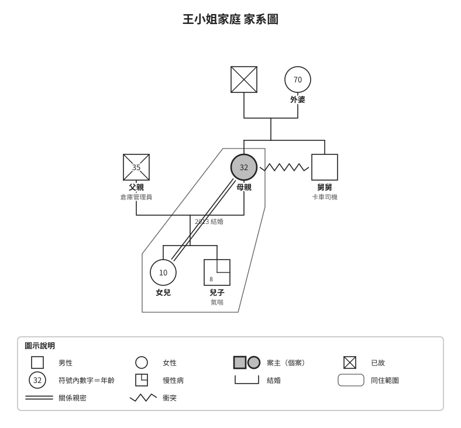
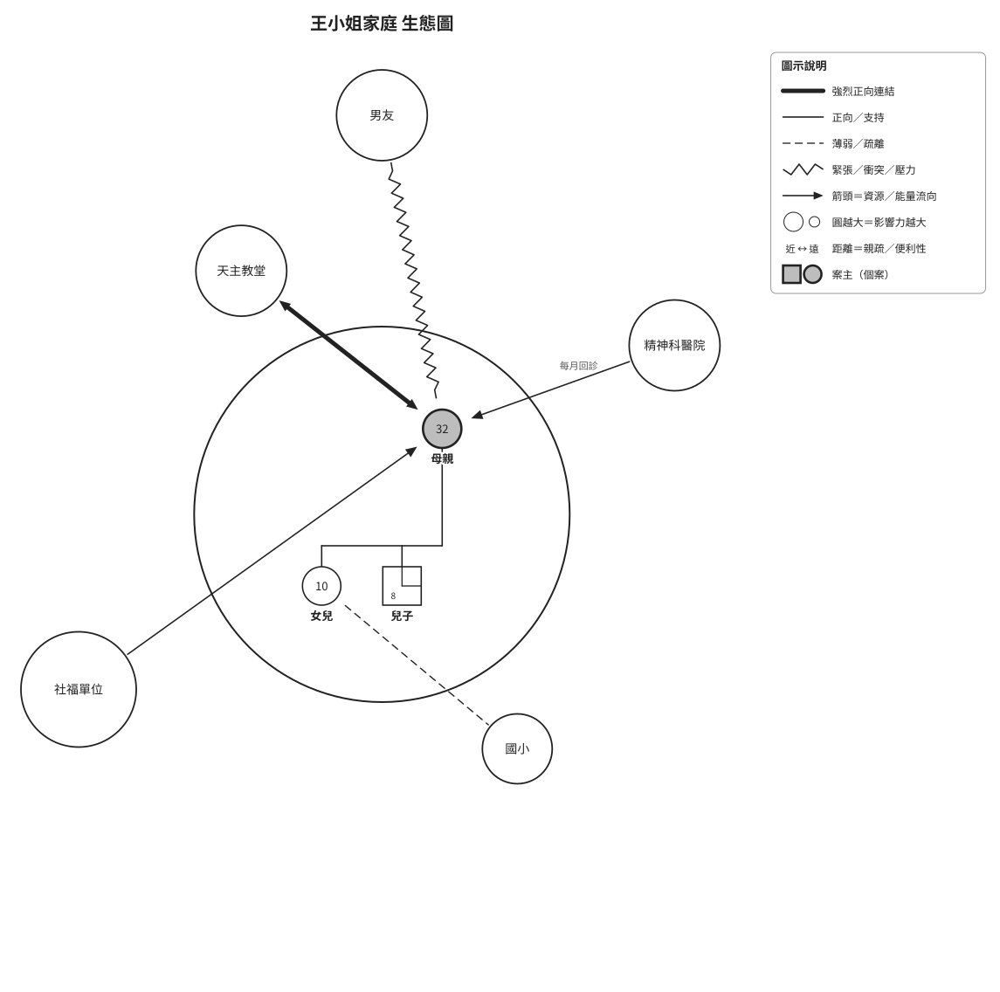

# 家系圖 × 生態圖技能（genogram-ecomap）

把一段家庭敘述轉成兩張標準化評估圖：先畫**家系圖（Genogram）**，再畫**生態圖（Ecomap）**，最後附上評估觀察與待補資訊。符號依社工實務標準，供社工、諮商、醫療評估使用。

## 範例輸出

以下是虛構案例 [`examples/sample-case.json`](examples/sample-case.json) 的產出。

| 家系圖 | 生態圖 |
|---|---|
|  |  |

## 安裝

### Claude Code

```bash
git clone https://github.com/chichinliu/genogram-ecomap-skill.git
cp -R genogram-ecomap-skill/genogram-ecomap ~/.claude/skills/
```

### Claude.ai

把 `genogram-ecomap` 資料夾壓縮成 zip，到「設定 → 技能」上傳。

## 使用方式

安裝後直接描述家庭狀況即可，例如：

> 幫我畫家系圖和生態圖。案主是 32 歲的母親，先生已過世，育有一女一子，目前三人同住……

需要 Python 3。環境有 playwright 時會同時輸出 PNG，否則只輸出 SVG。

## 檔案結構

```text
genogram-ecomap/SKILL.md   技能本體，繪圖程式 genoeco.py 內嵌在文件最後
examples/                  虛構範例的輸入與輸出
```

## 個案資料注意事項

個案資料屬於敏感個資，請不要提交到這個 repo。`.gitignore` 已排除 `case*.json` 與 `out/`，但其他檔名不會被擋下。範例一律使用虛構內容，公開 repo 前請再次檢查。
